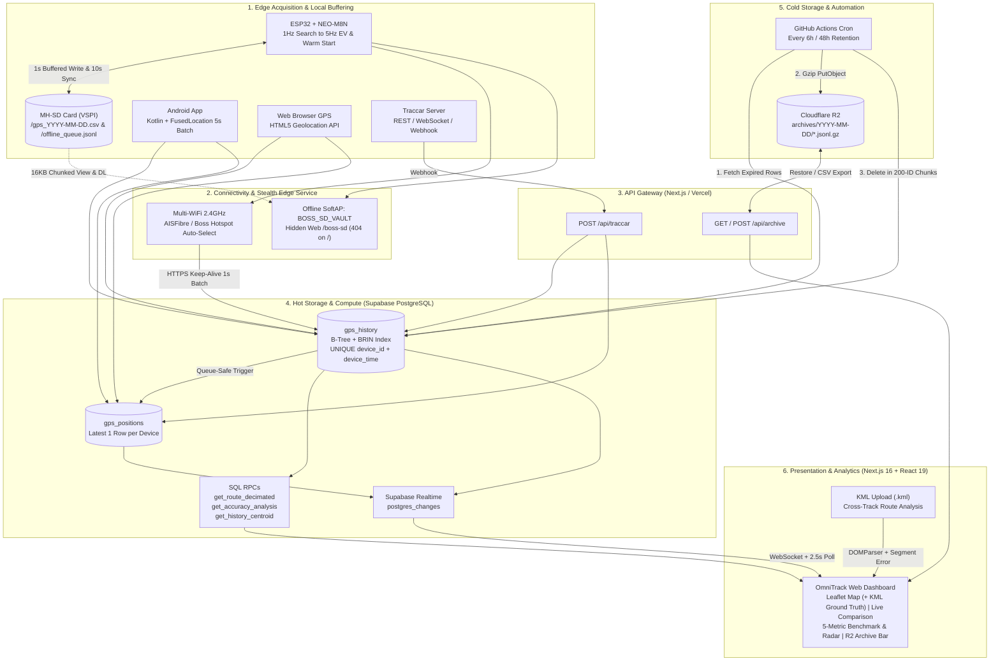
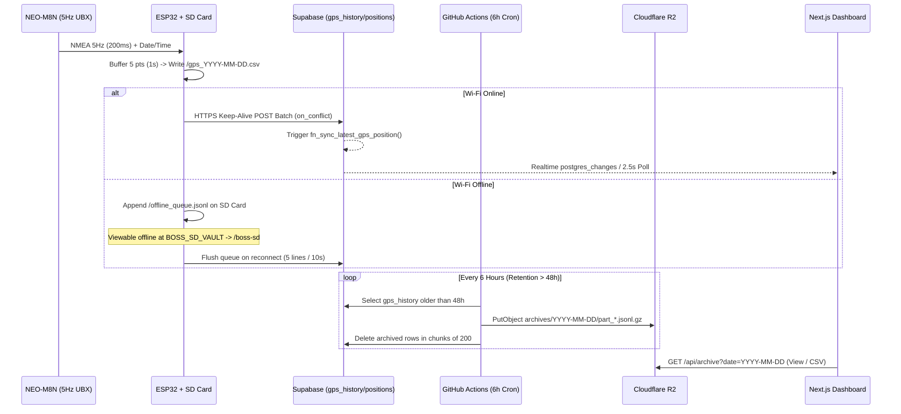

# 🛰️ OmniTrack GPS Platform — Updated Tech Stack & Operational Architecture

เอกสารสรุป **Tech Stack ฉบับอัปเดตล่าสุด** และ **Operational Layers (6 ชั้น)** สำหรับใช้อ้างอิงและวาด Architecture / System / Sequence Diagram ของระบบทั้งหมด (Edge Hardware, API Gateway, Hot PostgreSQL, Cold Cloudflare R2 Archive และ Web Dashboard)

---

## 1. Tech Stack ล่าสุด (Full Stack)

| หมวด (Category) | เทคโนโลยี / เวอร์ชันที่ใช้งานจริง | บทบาทหลัก |
| :--- | :--- | :--- |
| **Edge Hardware / IoT** | `ESP32 Dev Module` (Arduino Core `3.3.0`), `u-blox NEO-M8N` (`UBX` + NMEA `5Hz` / `115200 bps`), `TinyGPS++ 1.0.3`, `MH-SD Card Module` (`VSPI 2MHz/1MHz`) | จับพิกัดความถี่ `5Hz` โหมด EV, ทำ Warm Start, และบันทึกลง SD Card รายวัน + Offline Queue |
| **Edge Connectivity & Stealth Web** | `ESP32 WebServer` (`PROGMEM` HTML5/JS Vault @ `/boss-sd`), `WIFI_AP_STA` (`Multi-WiFi 2.4GHz` + Offline AP `BOSS_SD_VAULT`), `HTTPClient` Keep-Alive | อ่าน/ดาวน์โหลดไฟล์ทั้งหมดบน SD Card ผ่านเบราว์เซอร์แบบออฟไลน์ (หน้า `/` ตอบ `404`) และส่ง Batch ขึ้น Cloud |
| **Mobile & Other Sources** | Android Native (`Kotlin`, SDK `26–34`, `FusedLocationProviderClient`, `OkHttp 4.12.0`), HTML5 Geolocation API, `Traccar` (`REST / WebSocket / Webhook`) | แหล่งส่งพิกัดเปรียบเทียบความแม่นยำร่วมกับ IoT ESP32 |
| **Web Frontend** | `Next.js 16.4.3` (App Router), `React 19.3.0`, `TypeScript 5`, Tailwind CSS, `lucide-react 1.54.0` | หน้าเว็บแดชบอร์ดแสดงแผนที่ ตารางเปรียบเทียบ และแผงวิเคราะห์ |
| **Map & Data Visualization** | `Leaflet 1.9.4`, `react-leaflet 5.0.0`, `Recharts 3.10.1`, KML XML Parser (`DOMParser`) | วาดเส้นทางบนแผนที่แบบ Decimation, ซ้อนเส้นทางอ้างอิง `.kml`, ลูกศรทิศทาง, Radar Chart และตาราง Telemetry Benchmark |
| **Hot Database & Compute** | `Supabase` (`@supabase/supabase-js 2.117.3`), `PostgreSQL` (`B-Tree + BRIN Index`, `PL/pgSQL Trigger`, `SQL RPCs`), `Supabase Realtime` (`postgres_changes`) | เก็บสถานะล่าสุด + ประวัติ Time-Series, ประมวลผล Analysis ระดับล้านแถวบน Server, และส่ง Real-time Stream |
| **Cold Archive Storage** | `Cloudflare R2` (S3-compatible API via `@aws-sdk/client-s3 3.1169.0`), `zlib` Gzip Level-9 NDJSON (`archives/YYYY-MM-DD/*.jsonl.gz`) | เก็บประวัติเก่าเกิน Retention Window ระยะยาวแบบบีบอัด แยกตามวันที่กรุงเทพฯ |
| **DevOps & Lifecycle Cron** | `Vercel` (Next.js Hosting + API Routes), `GitHub Actions` (`ci.yml` + `archive-r2.yml` Cron ทุก 6 ชม. บน Node `20`) | Build/Deploy อัตโนมัติ และย้ายข้อมูลเก่าจาก Supabase ไป Cloudflare R2 ตามตารางเวลา |

---

## 2. Operational Layers (6 ชั้นการทำงาน)

### Layer 1: Edge Acquisition & Local Buffering Layer (ชั้นรับพิกัดจากอุปกรณ์)
* **IoT EV Tracker (`ESP32_Tracker/ESP32_Tracker.ino`):**
  * **Auto-Baud & 2-Phase Lock:** ทดสอบ UART `115200 bps` (มี Fallback `9600 bps`), เริ่มค้นหาดาวเทียมที่ `1Hz Portable` + `Auto 2D/3D` -> ทันทีที่จับตำแหน่งได้จะอัปเกรดเป็น `5Hz Automotive` (`200 ms`) อัตโนมัติ
  * **Warm Start Assistance:** ฉีดเวลา UTC จาก NTP และพิกัดล่าสุดจาก Flash NVS (`Preferences`) เข้าชิป NEO-M8N ผ่านคำสั่ง `UBX-MGA-INI`
  * **1s Buffered SD Storage & Recovery:** บัฟเฟอร์จุด `5Hz` (5 จุด/วิ) แล้วเขียนลงไฟล์รายวัน `/gps_YYYY-MM-DD.csv` ทุก `1 วินาที` พร้อม `MISO INPUT_PULLUP`, SPI `2MHz/1MHz` และระบบ `recoverSDCard()` เมื่อเกิดไฟกระชาก
  * **Offline Queue Management:** รายการที่ส่งไม่สำเร็จจะพักใน `/offline_queue.jsonl` (และย้ายแถว `HTTP 4xx` ที่เสียถาวรไป `/offline_bad.jsonl` อัตโนมัติ เพื่อไม่ให้ขวางคิวดี)
* **Android Native App (`MobileApp/`):** รัน Background Foreground Service + WakeLock, ส่งพิกัดแบบ Batch ทุก `5 วินาที`
* **Web Browser GPS & Traccar:** เก็บพิกัดฝั่ง Browser (`useBrowserGPS.ts`) และเชื่อมต่อ Traccar (`useTraccar.ts`)

### Layer 2: Edge Network & Local Service Layer (ชั้นเชื่อมต่อและเว็บลับออฟไลน์)
* **Multi-WiFi 2.4GHz Auto-Select:** สแกน Wi-Fi `2.4 GHz` รอบตัวแล้วเลือกเครือข่ายใน `WIFI_LIST[]` ที่สัญญาณแรงสุดอัตโนมัติ (เช่น Wi-Fi บ้าน `AISFibre_C11_812_2.4G` หรือ Hotspot มือถือ `Boss`)
* **AP+STA Offline Access (`BOSS_SD_VAULT`):** เปิด SoftAP บน Channel เดียวกับ STA (หรือ Channel `1` เมื่อออฟไลน์) พร้อมตั้ง IP คงที่ `192.168.4.1` และพักการสแกน STA ชั่วคราวเมื่อมีเครื่องเกาะ AP
* **Hidden Standalone SD Web Reader:** เสิร์ฟหน้าเว็บ HTML5/JS จาก `PROGMEM` เฉพาะพาธลับ `/boss-sd` (พาธ `/` และพาธอื่นตอบ `404 Not Found`) รองรับสแกนไฟล์ทั้งหมดใน SD, เปิดอ่านแบบ Streaming Chunk `16 KB` (โหมดตาราง CSV/JSONL + ลิงก์แผนที่ และโหมดข้อความดิบ), ดาวน์โหลด และลบไฟล์
* **HTTPS Keep-Alive Sync:** รวบ Batch ทุก `1 วินาที` (`~5 จุด/Request`) ส่งตรงเข้า Supabase แบบ Connection Reuse (`on_conflict=device_id,device_time`) และทยอยซิงก์ `/offline_queue.jsonl` ทุก `10 วินาที`

### Layer 3: API Gateway & Ingestion Layer (`Web/src/app/api/`)
* **`POST /api/traccar` (`Web/src/app/api/traccar/route.ts`):**
  * ตรวจสอบ Token (`TRACCAR_SECRET`), แปลงความเร็วจาก `knots × 1.852 -> km/h`, แล้วเขียนลงทั้ง `gps_positions` (Upsert) และ `gps_history` (Insert)
* **`GET / POST /api/archive` (`Web/src/app/api/archive/route.ts`):**
  * `GET`: ตรวจสอบสถานะการตั้งค่า R2, ดึงรายชื่อวันที่ที่มี Archive (`listR2ArchiveDays`), หรือดึงข้อมูลย้อนหลังตามวันที่ (`?date=YYYY-MM-DD`, รองรับ `?format=csv`)
  * `POST`: ทริกเกอร์งานย้ายข้อมูลเก่าจาก Supabase -> Cloudflare R2 (ป้องกันด้วย `CRON_SECRET`)

### Layer 4: Hot Data Storage & Server Compute Layer (Supabase PostgreSQL)
* **`public.gps_positions`:** เก็บสถานะล่าสุดเพียง `1 แถวต่อ 1 อุปกรณ์` (`UNIQUE device_id`) สำหรับปักหมุด Live Map และตาราง Live Comparison
* **`public.gps_history`:** เก็บประวัติ Time-Series ทั้งหมดแบบ Dual-Timestamp (`device_time`, `server_time`, `recorded_at`) พร้อม `UNIQUE(device_id, device_time)`
* **Queue-Safe Trigger (`fn_sync_latest_gps_position` / `trg_sync_gps_positions`):** ป้องกันคิว Offline ย้อนหลังมาเขียนทับตำแหน่งปัจจุบันที่ใหม่กว่า
* **Million-Row Indexes (`supabase_scale_1m.sql`):**
  * Composite B-Tree `(device_id, device_time DESC)`, `(device_id, server_time DESC)`, `(server_time DESC)`
  * **BRIN Indexes** (`idx_gps_history_brin_server_time`, `idx_gps_history_brin_device_time`)
* **Server-Side SQL RPCs:**
  * `get_route_decimated(p_points_per_device, p_device_id, p_source)` — Decimate จุดเส้นทางบน PostgreSQL ก่อนส่งเข้าเบราว์เซอร์
  * `get_accuracy_analysis(p_ref_lat, p_ref_lng)` — คำนวณ Haversine Error (`Mean`, `StdDev`, `Min`, `Max`, `Avg Acc`) บน Server
  * `get_history_centroid()` — หาจุดกึ่งกลางอ้างอิงจากข้อมูลทั้งหมด
* **Realtime Publication:** `supabase_realtime` (`postgres_changes`) บนทั้ง 2 ตาราง + Polling Fallback ทุก `2.5 วินาที`

### Layer 5: Cold Storage & Lifecycle Automation Layer (Cloudflare R2 + GitHub Actions)
* **Scheduled Job (`.github/workflows/archive-r2.yml`):** รันอัตโนมัติทุก `6 ชั่วโมง` (`0 */6 * * *`) ด้วย Node `20` เรียกสคริปต์ `Web/scripts/archive-to-r2.mjs`
* **Archive & Prune Pipeline (`Web/src/lib/r2Archive.ts`):**
  1. ดึงแถวใน `gps_history` ที่ `server_time` เก่ากว่า `ARCHIVE_RETENTION_HOURS` (ค่าเริ่มต้น `48 ชม.`) ทีละ Batch
  2. จัดกลุ่มตามวันที่เวลาไทย (`Asia/Bangkok`), แปลงเป็น NDJSON แล้วบีบอัด Gzip Level 9 (`archives/YYYY-MM-DD/part_*.jsonl.gz`)
  3. อัปโหลดขึ้น **Cloudflare R2** ผ่าน `S3Client` (`PutObjectCommand`)
  4. เมื่อ R2 ตอบกลับสำเร็จ (`< 300`) จึงลบแถวต้นทางออกจาก Supabase ทีละ `200 ID`

### Layer 6: Presentation & Analytics Layer (Next.js Dashboard UI)
* **Map Visualization (`Web/src/components/MapComponent.tsx`):** แผนที่ Leaflet, เส้นทางที่ Decimate แล้ว, ลูกศรทิศทาง, การซ้อนแสดงผลข้อมูลที่โหลดกลับมาจาก Cloudflare R2 และซ้อนเส้นทางอ้างอิง `.kml` แบบเส้นประ (`Ground Truth`)
* **Comparison & History (`Web/src/components/DataTables.tsx`, `CloudArchiveBar.tsx`):**
  * **Live Tracking Comparison:** เลือกเปรียบเทียบ Device ข้ามกลุ่มได้ พร้อมแถบสถานะ `LIVE Xs`
  * **History Log:** แบ่งหน้าแบบ Server-Side Pagination (`.range()`), แสดง `Date` + `Time`, และแถบ **Cloud Archive Bar** สำหรับโหลด/ดาวน์โหลด CSV จาก R2 ตามวัน
* **Accuracy & Telemetry Benchmark (`Web/src/components/AnalysisPanel.tsx`, `Web/src/utils/calculations.ts`):**
  * วิเคราะห์ความแม่นยำ **5 โหมดอ้างอิง**: `Auto Centroid`, `เทียบ Device หลัก`, `Live GPS`, `กำหนดเอง`, และ **`KML Main Route`** (รองรับอัปโหลดไฟล์ `.kml` ทั้ง `LineString`, `gx:Track`, `Point` คำนวณ Cross-Track Segment Error บนเส้นทางจริง)
  * **Route & Telemetry Benchmark Matrix (5 Metrics):** เปรียบเทียบทุกแหล่ง (`IoT Data`, `API / Traccar`, `Native`, `Browser`, `KML Manual Route`) ใน 5 มิติ:
    1. `Accuracy (Avg Error on Main Route)` (`m`)
    2. `Update Interval` (`s`)
    3. `Average Speed` (`m/s`)
    4. `Data Consistency` (`%`)
    5. `Availability / Uptime` (`%`)
  * ตาราง `Device Accuracy Ranking` (แสดงครบทั้ง Error, Interval, Speed, Consistency, Uptime) และ `RadarChart` (Recharts)

---

## 3. System Architecture Diagram (Mermaid)

---

## 4. Operational Data Flow (Sequence Diagram)

