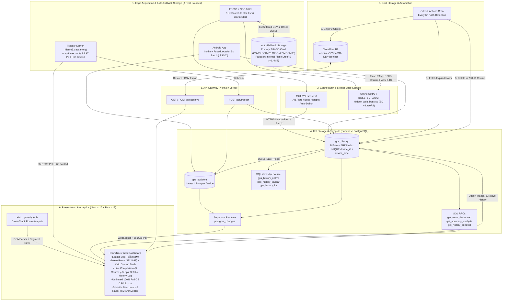

# 🛰️ OmniTrack GPS Platform — Updated Tech Stack & Operational Architecture

เอกสารสรุป **Tech Stack ฉบับอัปเดตล่าสุด** และ **Operational Layers (6 ชั้น)** สำหรับใช้อ้างอิงและวาด Architecture / System / Sequence Diagram ของระบบทั้งหมด (Edge Hardware 5Hz + Auto-Fallback Storage, API Gateway, Hot PostgreSQL + Per-Source SQL Views, Cold Cloudflare R2 Archive และ Web Dashboard พร้อมเส้นค่ากลาง Mean Route & 3-Table History Log)

---

## 1. Tech Stack ล่าสุด (Full Stack)

| หมวด (Category) | เทคโนโลยี / เวอร์ชันที่ใช้งานจริง | บทบาทหลัก |
| :--- | :--- | :--- |
| **Edge Hardware / IoT** | `ESP32 Dev Module` (Arduino Core `3.3.0`), `u-blox NEO-M8N` (`UBX` + NMEA `5Hz` / `115200 bps`), `TinyGPS++ 1.0.3`, `MH-SD Card Module` (`SPI: CS=25, SCK=26, MISO=27, MOSI=33 @ 2MHz/1MHz`) + `LittleFS` Internal Flash (`~1.4 MB`) | จับพิกัดความถี่ `5Hz` โหมด EV, ทำ Warm Start, และบันทึกลง SD Card รายวันพร้อม **Auto-Fallback ลง LittleFS ในตัวชิป ESP32 อัตโนมัติเมื่อไม่ได้เสียบการ์ด** (ถอด Firebase ออกทั้งหมด) |
| **Edge Connectivity & Stealth Web** | `ESP32 WebServer` (`PROGMEM` HTML5/JS Vault @ `/boss-sd`), `WIFI_AP_STA` (`Multi-WiFi 2.4GHz` + Offline AP `BOSS_SD_VAULT`), `HTTPClient` Keep-Alive | อ่าน/ดาวน์โหลดไฟล์ทั้งหมดจากทั้ง SD Card และ LittleFS ผ่านเบราว์เซอร์แบบออฟไลน์ (หน้า `/` ตอบ `404`) และส่ง Batch ขึ้น Supabase โดยตรง |
| **Mobile & Other Sources** | Android Native (`Kotlin`, SDK `26–34`, `FusedLocationProviderClient`, `OkHttp 4.12.0`, Millisecond Batch Upsert `.SSS'Z'`), `Traccar` (`demo3.traccar.org` Auto-Detect, 3s REST Poll + WebSocket + 6h History Backfill + Webhook) | แหล่งส่งพิกัดเปรียบเทียบความแม่นยำร่วมกับ IoT ESP32 (ตัดการเก็บ Browser GPS และ Firebase Bridge ออกทั้งหมด เหลือ 3 แหล่งข้อมูลฮาร์ดแวร์/มือถือจริง) |
| **Web Frontend** | `Next.js 16.4.3` (App Router), `React 19.3.0`, `TypeScript 5`, Tailwind CSS, `lucide-react 1.54.0` | หน้าเว็บแดชบอร์ดแสดงแผนที่ ตารางเปรียบเทียบ ตาราง History Log แยก 3 อุปกรณ์ และแผงวิเคราะห์ |
| **Map & Data Visualization** | `Leaflet 1.9.4` (`preferCanvas: true`), `react-leaflet 5.0.0`, `Recharts 3.10.1`, KML XML Parser (`DOMParser`), Multi-Device Consensus Mean Route (`computeConsensusMeanRoute`) | วาดเส้นทางบนแผนที่แบบ Decimation, วาด **เส้นค่ากลาง (`#EC4899` Mean Route)** เฉลี่ยจากหลายอุปกรณ์, ซ้อนเส้นทางอ้างอิง `.kml` (`#FACC15`), Radar Chart และตาราง Telemetry Benchmark 5 มิติ |
| **Hot Database & Compute** | `Supabase` (`@supabase/supabase-js 2.117.3`), `PostgreSQL` (`B-Tree + BRIN Index`, `PL/pgSQL Trigger`, `SQL RPCs`, `SQL Views`), `Supabase Realtime` (`postgres_changes`) | เก็บสถานะล่าสุด + ประวัติ Time-Series, แยก SQL Views รายแหล่ง (`gps_history_native`, `gps_history_traccar`, `gps_history_iot`), ประมวลผล Analysis ระดับล้านแถวบน Server, และส่ง Real-time Stream |
| **Cold Archive Storage** | `Cloudflare R2` (S3-compatible API via `@aws-sdk/client-s3 3.1169.0`), `zlib` Gzip Level-9 NDJSON (`archives/YYYY-MM-DD/*.jsonl.gz`) | เก็บประวัติเก่าเกิน Retention Window ระยะยาวแบบบีบอัด แยกตามวันที่กรุงเทพฯ |
| **DevOps & Lifecycle Cron** | `Vercel` (Next.js Hosting + API Routes), `GitHub Actions` (`ci.yml` + `archive-r2.yml` Cron ทุก 6 ชม. บน Node `20`) | Build/Deploy อัตโนมัติ และย้ายข้อมูลเก่าจาก Supabase ไป Cloudflare R2 ตามตารางเวลา |

---

## 2. Operational Layers (6 ชั้นการทำงาน)

### Layer 1: Edge Acquisition & Auto-Fallback Storage Layer (ชั้นรับพิกัดจากอุปกรณ์จริง 3 แหล่ง)
* **IoT EV Tracker (`ESP32_Tracker/ESP32_Tracker.ino` — Direct Supabase, No Firebase):**
  * **Auto-Baud & 2-Phase Lock:** ทดสอบ UART `115200 bps` (มี Fallback `9600 bps`), เริ่มค้นหาดาวเทียมที่ `1Hz Portable` + `Auto 2D/3D` -> ทันทีที่จับตำแหน่งได้จะอัปเกรดเป็น `5Hz Automotive` (`200 ms`) อัตโนมัติ
  * **Warm Start Assistance:** ฉีดเวลา UTC จาก NTP และพิกัดล่าสุดจาก Flash NVS (`Preferences`) เข้าชิป NEO-M8N ผ่านคำสั่ง `UBX-MGA-INI`
  * **Auto-Fallback Storage (`SD Card` -> `LittleFS Internal Flash`):**
    * ต่อสาย SPI ฝั่งเดียวกัน (`CS=25, SCK=26, MISO=27, MOSI=33, VCC=VIN 5V, GND=GND`) บัฟเฟอร์จุด `5Hz` (5 จุด/วิ) แล้วเขียนลงไฟล์รายวัน `/gps_YYYY-MM-DD.csv` ทุก `1 วินาที`
    * หากไม่พบ SD Card หรือสายหลวม ระบบสลับมาเขียนลง **`LittleFS` (Internal Flash ในตัวบอร์ด ESP32 ~1.4 MB)** อัตโนมัติทันทีโดยไม่เสียข้อมูลแม้แต่จุดเดียว (พร้อมกันพื้นที่ 64KB สุดท้ายของ LittleFS ไว้ให้ Offline Queue เสมอ)
  * **Offset-Based Offline Queue (`/offline_queue.jsonl` + `/offline_queue.pos`):**
    * เก็บคิวออฟไลน์โดยจำตำแหน่ง Byte Offset ที่ส่งถึงแล้วไว้ใน `/offline_queue.pos` **ไม่ต้องเขียนทับหรือ Copy ไฟล์คิวใหม่ทุกรอบ** ลดการสึกหรอของการ์ดและทำให้ส่งคิวเร็วขึ้น (`10 batches` ทุก `2 วินาที` เมื่อมีคิวค้าง ทั้งจาก `LittleFS` และ `SD Card`)
* **Android Native App (`MobileApp/`):** รัน Background Foreground Service + WakeLock, อ่านพิกัดทุก `2 วินาที` และส่ง Batch Upsert เข้า Supabase ทุก `5 วินาที` ด้วยเวลาความละเอียดมิลลิวินาที (`yyyy-MM-dd'T'HH:mm:ss.SSS'Z'`) พร้อม `on_conflict=device_id,device_time`
* **Traccar Mobile Client (`useTraccar.ts` -> `demo3.traccar.org`):** ส่งพิกัดจากแอป Traccar Client (`uniqueId: 66987654`) เข้าเซิร์ฟเวอร์ `demo3.traccar.org` และซิงก์เข้า Supabase อัตโนมัติผ่าน REST Polling ทุก `3 วินาที` + WebSocket + ดึงประวัติย้อนหลัง `6 ชั่วโมง`

### Layer 2: Edge Network & Local Service Layer (ชั้นเชื่อมต่อและเว็บลับออฟไลน์)
* **Multi-WiFi 2.4GHz Auto-Select:** สแกน Wi-Fi `2.4 GHz` รอบตัวแล้วเลือกเครือข่ายใน `WIFI_LIST[]` ที่สัญญาณแรงสุดอัตโนมัติ (เช่น Wi-Fi บ้าน `AISFibre_C11_812_2.4G` หรือ Hotspot มือถือ `Boss`) พร้อมสลับเครือข่ายอัตโนมัติทุก 20 วินาทีเมื่อยังเชื่อมไม่ติด
* **AP+STA Offline Access (`BOSS_SD_VAULT`):** เปิด SoftAP บน Channel เดียวกับ STA (หรือ Channel `1` เมื่อออฟไลน์) พร้อมตั้ง IP คงที่ `192.168.4.1` และพักการสแกน STA ชั่วคราวเมื่อมีเครื่องเกาะ AP
* **Hidden Standalone Storage Web Reader (`/boss-sd`):** เสิร์ฟหน้าเว็บ HTML5/JS จาก `PROGMEM` เฉพาะพาธลับ `/boss-sd` (พาธ `/` ตอบ `404 Not Found`) รองรับสแกนไฟล์ทั้งหมดจากทั้ง **SD Card และ LittleFS Internal Flash**, Flush ข้อมูลใน RAM ลงหน่วยความจำก่อนเปิดอ่านเสมอ, พรีวิวตาราง CSV/JSONL แบบ Chunk `16 KB`, ดาวน์โหลด และลบไฟล์
* **HTTPS Keep-Alive Sync:** รวบ Batch ทุก `1 วินาที` (`~5 จุด/Request`) ส่งตรงเข้า Supabase แบบ Connection Reuse (`on_conflict=device_id,device_time`)

### Layer 3: API Gateway & Ingestion Layer (`Web/src/app/api/`)
* **`POST /api/traccar` (`Web/src/app/api/traccar/route.ts`):**
  * ตรวจสอบ Token (`TRACCAR_SECRET`), แปลงความเร็วจาก `knots × 1.852 -> km/h`, แล้วเขียนลงทั้ง `gps_positions` (Upsert) และ `gps_history` (Insert)
* **`GET / POST /api/archive` (`Web/src/app/api/archive/route.ts`):**
  * `GET`: ตรวจสอบสถานะการตั้งค่า R2, ดึงรายชื่อวันที่ที่มี Archive (`listR2ArchiveDays`), หรือดึงข้อมูลย้อนหลังตามวันที่ (`?date=YYYY-MM-DD`, รองรับ `?format=csv`)
  * `POST`: ทริกเกอร์งานย้ายข้อมูลเก่าจาก Supabase -> Cloudflare R2 (ป้องกันด้วย `CRON_SECRET`)

### Layer 4: Hot Data Storage & Server Compute Layer (Supabase PostgreSQL)
* **`public.gps_positions`:** เก็บสถานะล่าสุดเพียง `1 แถวต่อ 1 อุปกรณ์` (`UNIQUE device_id`) สำหรับปักหมุด Live Map และตาราง Live Comparison (3 แหล่งข้อมูลจริง: `native`, `traccar`, `iot`)
* **`public.gps_history`:** เก็บประวัติ Time-Series ทั้งหมดแบบ Dual-Timestamp (`device_time`, `server_time`, `recorded_at`) พร้อม `UNIQUE(device_id, device_time)`
* **Per-Source SQL Views (`supabase_scale_1m.sql`):**
  * `public.gps_history_native` (`WHERE source = 'native'`)
  * `public.gps_history_traccar` (`WHERE source = 'traccar'`)
  * `public.gps_history_iot` (`WHERE source = 'iot'`)
* **Queue-Safe Trigger (`fn_sync_latest_gps_position` / `trg_sync_gps_positions`):** ป้องกันคิว Offline ย้อนหลังมาเขียนทับตำแหน่งปัจจุบันที่ใหม่กว่า
* **Million-Row Indexes & Server-Side SQL RPCs:**
  * Composite B-Tree + BRIN Indexes
  * `get_route_decimated(p_points_per_device, p_device_id, p_source)`
  * `get_accuracy_analysis(p_ref_lat, p_ref_lng)`
  * `get_history_centroid()`
* **Realtime Publication + Dual Polling Fallback:** `supabase_realtime` (`postgres_changes`) บนทั้ง 2 ตาราง ทำงานร่วมกับ Polling Fallback ทุก `2 วินาที` ที่ดึงทั้ง `gps_positions` และแถวใหม่ของ `gps_history` พร้อมแยกนับจำนวนแถวรายแหล่งข้อมูล (`loadSourceBreakdown`)

### Layer 5: Cold Storage & Lifecycle Automation Layer (Cloudflare R2 + GitHub Actions)
* **Scheduled Job (`.github/workflows/archive-r2.yml`):** รันอัตโนมัติทุก `6 ชั่วโมง` (`0 */6 * * *`) ด้วย Node `20` เรียกสคริปต์ `Web/scripts/archive-to-r2.mjs`
* **Archive & Prune Pipeline (`Web/src/lib/r2Archive.ts`):**
  1. ดึงแถวใน `gps_history` ที่ `server_time` เก่ากว่า `ARCHIVE_RETENTION_HOURS` (ค่าเริ่มต้น `48 ชม.`) ทีละ Batch
  2. จัดกลุ่มตามวันที่เวลาไทย (`Asia/Bangkok`), แปลงเป็น NDJSON แล้วบีบอัด Gzip Level 9 (`archives/YYYY-MM-DD/part_*.jsonl.gz`)
  3. อัปโหลดขึ้น **Cloudflare R2** ผ่าน `S3Client` (`PutObjectCommand`)
  4. เมื่อ R2 ตอบกลับสำเร็จ (`< 300`) จึงลบแถวต้นทางออกจาก Supabase ทีละ `200 ID`

### Layer 6: Presentation & Analytics Layer (Next.js Dashboard UI)
* **Map Visualization & Multi-Device Mean Route (`Web/src/components/MapArea.tsx`, `MapComponent.tsx`, `calculations.ts`):**
  * แผนที่ Leaflet (`preferCanvas: true`), วาดเส้นทางแต่ละอุปกรณ์พร้อมลูกศรทิศทาง, ซ้อนเส้นทางอ้างอิง `.kml` แบบเส้นประสีเหลือง (`#FACC15`)
  * **ปุ่ม `เส้นค่ากลาง ON / OFF` (Multi-Device Consensus Mean Route):** คำนวณและวาดเส้นที่ 4 สีชมพูบานเย็น (`#EC4899` ประขาว) เฉลี่ยจากทุกอุปกรณ์ที่กำลังแสดงบนแผนที่โดยให้น้ำหนักแต่ละเครื่องเท่ากัน (`5s time-bucket` -> `80-step arc-length resampling` -> `centroid`)
* **Comparison, Split 3-Table History Log & Full-DB Export (`Web/src/components/DataTables.tsx`, `page.tsx`):**
  * **Live Tracking Comparison:** เปรียบเทียบ 3 แหล่งข้อมูลจริง (`Native Android`, `Traccar`, `IoT ESP32`) พร้อมแถบสถานะ `LIVE Xs`
  * **Split 3-Table History Log (`โหมด: แยก 3 ตารางตามอุปกรณ์`):** แสดงตาราง History Log แยก 3 ตารางคู่กัน (`Native`, `Traccar`, `IoT`) พร้อมจำนวนแถวจริงใน DB และปุ่มสลับดูตารางรวม/รายแท็บ
  * **100% Full-Database CSV Export:** วนดึงข้อมูลทุกแถวของแต่ละแหล่งข้อมูลแบบขนาน (`while (true)` ทีละ 1,000 แถวจนหมดฐานข้อมูล ไม่มีเพดานตัดแถว) พร้อมแสดงความคืบหน้าสดและใส่ UTF-8 BOM (`\uFEFF`)
* **Accuracy & Telemetry Benchmark (`Web/src/components/AnalysisPanel.tsx`, `Web/src/utils/calculations.ts`):**
  * วิเคราะห์ความแม่นยำ **4 โหมดอ้างอิง**: `Auto Centroid`, `เทียบ Device หลัก`, `กำหนดเอง (Manual)`, และ **`KML Main Route`** (คำนวณ Cross-Track Segment Error บนเส้นทางจริง)
  * **Route & Telemetry Benchmark Matrix (5 Metrics):** เปรียบเทียบทุกแหล่ง (`IoT Data`, `API / Traccar`, `Native`, `KML Manual Route`) ใน 5 มิติ:
    1. `Accuracy (Avg Error on Main Route)` (`m`)
    2. `Update Interval` (`s`)
    3. `Average Speed` (`m/s`)
    4. `Data Consistency` (`%`)
    5. `Availability / Uptime` (`%`)
  * ตาราง `Device Accuracy Ranking` และ `RadarChart` (Recharts)

---

## 3. System Architecture Diagram (Mermaid)



---

## 4. Operational Data Flow (Sequence Diagram)

```mermaid
sequenceDiagram
    participant GPS as NEO-M8N (5Hz UBX)
    participant ESP as ESP32 (SD + LittleFS Fallback)
    participant TRC as Traccar (demo3.traccar.org)
    participant AND as Android Native App
    participant DB as Supabase (gps_history/positions)
    participant R2 as Cloudflare R2 (6h Cron)
    participant WEB as Next.js Dashboard

    GPS->>ESP: NMEA 5Hz (200ms) + Date/Time
    ESP->>ESP: Buffer 5 pts (1s) -> Write /gps_YYYY-MM-DD.csv (SD Card or LittleFS Fallback)
    alt Wi-Fi Online
        ESP->>DB: HTTPS Keep-Alive POST Batch (on_conflict=device_id,device_time)
        DB-->>DB: Trigger fn_sync_latest_gps_position()
    else Wi-Fi Offline
        ESP->>ESP: Append /offline_queue.jsonl (SD or LittleFS)
        Note over ESP: Viewable offline at BOSS_SD_VAULT -> http://192.168.4.1/boss-sd
        ESP->>DB: Flush queue via /offline_queue.pos offset (10 batches / 2s)
    end
    AND->>DB: Batch Upsert every 5s (.SSS'Z', on_conflict=device_id,device_time)
    TRC->>WEB: 3s REST Poll + WebSocket + 6h History Backfill
    WEB->>DB: Upsert Traccar_27574 & Native into gps_history + gps_positions
    DB-->>WEB: Realtime postgres_changes + 2s Poll + Per-Source Breakdown (3 Split Tables)
    WEB->>WEB: Compute Multi-Device Mean Route (#EC4899) & 5-Metric KML Benchmark
    WEB->>DB: Full-DB Parallel Pagination Export (100% rows -> UTF-8 BOM CSV)
    DB->>R2: Every 6h Archive rows > 48h to archives/YYYY-MM-DD/part_*.jsonl.gz
```
