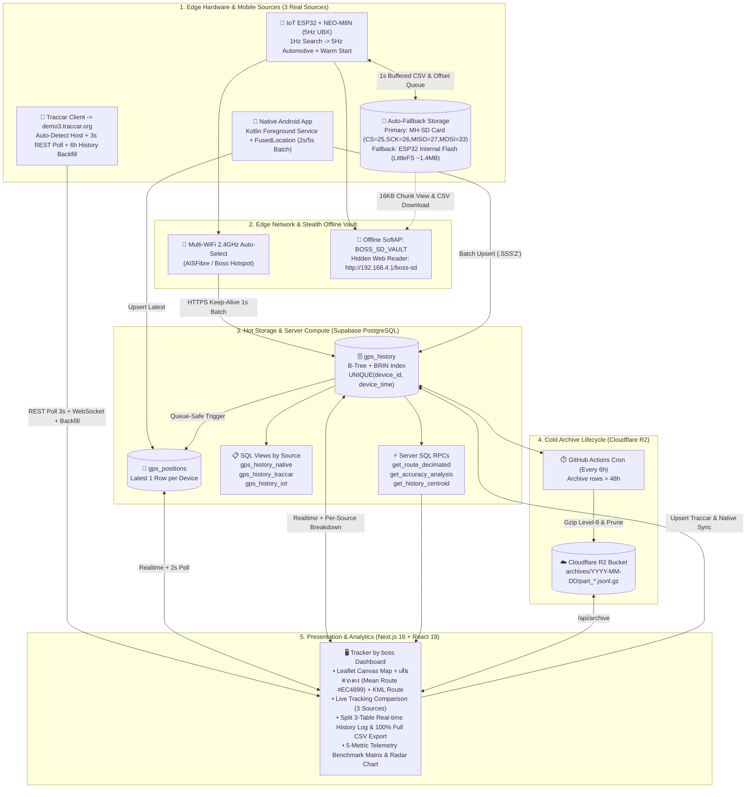
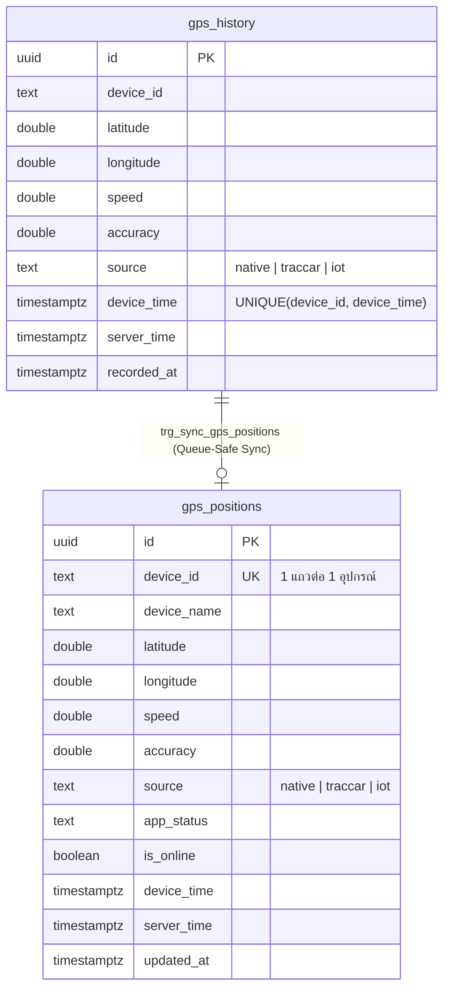

# 🛰️ Tracker by boss (OmniTrack GPS Platform)

ระบบติดตามตำแหน่ง GPS ความถี่สูงแบบเรียลไทม์และวิเคราะห์ความแม่นยำหลายอุปกรณ์พร้อมกัน (**Multi-Device Real-Time GPS Tracking, Consensus Mean Route & Accuracy Benchmark Platform**) รองรับ 3 แหล่งข้อมูลฮาร์ดแวร์/มือถือจริง ได้แก่ **Native Android App**, **Traccar Server (`demo3.traccar.org`)**, และ **IoT ESP32 (5Hz u-blox NEO-M8N + SD Card / LittleFS Auto-Fallback)** เชื่อมต่อตรงเข้าสู่ **Supabase PostgreSQL + Realtime** พร้อมระบบ **Cloudflare R2 Cold Archive** และแสดงผลเปรียบเทียบความแม่นยำพร้อม **เส้นค่ากลาง (Mean Route)** บนแผนที่แบบอัตโนมัติ

---

## 📑 สารบัญ

1. [ฟีเจอร์เด่นที่อัปเดตล่าสุด (Key Highlights)](#-ฟีเจอร์เด่นที่อัปเดตล่าสุด-key-highlights)
2. [สถาปัตยกรรมระบบและโครงสร้างโฟลเดอร์](#-สถาปัตยกรรมระบบและโครงสร้างโฟลเดอร์)
3. [เทคโนโลยีที่ใช้ทั้งหมด (Tech Stack)](#-เทคโนโลยีที่ใช้ทั้งหมด-tech-stack)
4. [โครงสร้างฐานข้อมูล Supabase & SQL Views](#-โครงสร้างฐานข้อมูล-supabase--sql-views)
5. [วิธีการเชื่อมต่อแต่ละส่วน (Connection & Hardware Pinout Guide)](#-วิธีการเชื่อมต่อแต่ละส่วน-connection--hardware-pinout-guide)
6. [หลักการคำนวณ เส้นค่ากลาง (Mean Route) และ Accuracy Analysis](#-หลักการคำนวณ-เส้นค่ากลาง-mean-route-และ-accuracy-analysis)
7. [เงื่อนไขการใช้งานและข้อควรระวัง](#-เงื่อนไขการใช้งานและข้อควรระวัง)

---

## ✨ ฟีเจอร์เด่นที่อัปเดตล่าสุด (Key Highlights)

* **🧭 ปุ่มดู "เส้นค่ากลาง" (Multi-Device Consensus Mean Route) บนแผนที่:**
  * เมื่อมีอุปกรณ์ตั้งแต่ 2 เครื่องขึ้นไปบนแผนที่ (เช่น เทียบ 3 อุปกรณ์ 3 เส้น) สามารถกดปุ่ม **`เส้นค่ากลาง ON / OFF`** มุมขวาบนของแผนที่เพื่อวาด **เส้นที่ 4 (เส้นค่ากลางสีชมพูบานเย็น `#EC4899` ประขาว)** ที่คำนวณค่าเฉลี่ยถ่วงน้ำหนักเท่ากันทุกอุปกรณ์โดยไม่ถูกดึงเอียงโดยเครื่องที่ส่งความถี่สูง (`5Hz`)
* **💾 ระบบ Auto-Fallback บน ESP32 (`SD Card` + `LittleFS Internal Flash`) แบบไร้ Firebase:**
  * ถอดโค้ดและไลบรารี Firebase ออกทั้งหมด ส่งข้อมูลตรงเข้า Supabase ผ่าน HTTPS Keep-Alive Batch (`5Hz` = 5 จุด/วินาที)
  * ย้ายขา SPI ของ SD Card มาเรียงฝั่งเดียวกันเสียบสายง่าย (`CS=25, SCK=26, MISO=27, MOSI=33`)
  * หากไม่ได้เสียบ SD Card หรือสายหลวม บอร์ดจะ **สลับมาบันทึกลงหน่วยความจำภายในชิป ESP32 (`LittleFS` ~1.4 MB) ให้อัตโนมัติทันที** พร้อมระบบคิวออฟไลน์แบบจำตำแหน่งอ่าน (`/offline_queue.pos`) ไม่ต้องเขียนทับไฟล์คิวซ้ำ และเปิดดู/ดาวน์โหลดไฟล์ผ่านเว็บลับ `/boss-sd` ได้ทั้งจาก SD Card และ LittleFS
* **📊 ตาราง History Log แบบ "แยก 3 ตารางตามอุปกรณ์" & ระบบ Export CSV ครบ 100% ทุกแถว:**
  * แสดงตาราง History Log แยก 3 ตารางคู่กัน (**Native Android**, **Traccar**, **IoT ESP32 5Hz**) พร้อมแถบสลับดูรายแหล่งและตัวเลขจำนวนแถวจริงในฐานข้อมูลแบบ Real-time ทำให้ข้อมูล `5Hz` ของ IoT ไม่เบียดบังข้อมูลของ Native และ Traccar
  * ปุ่ม **Export CSV** (ทั้งแบบรวมทุกแหล่งและแยกเฉพาะอุปกรณ์) วนดึงข้อมูลจาก Supabase ทีละ 1,000 แถวแบบไม่จำกัดเพดานจนครบ 100% ของทุกแหล่ง พร้อมแสดงความคืบหน้าสด (`กำลังดึงข้อมูล... X,XXX แถว`) และใส่ UTF-8 BOM (`\uFEFF`) เปิดใน Excel ภาษาไทยไม่เพี้ยน
* **📐 วิเคราะห์เทียบเส้นทางจริง `.kml` (Ground Truth) & ตาราง Benchmark 5 มิติ:**
  * อัปโหลดไฟล์ `.kml` เพื่อวาดเส้นทางมาตรฐานสีเหลืองประ (`#FACC15`) บนแผนที่ และคำนวณระยะคลาดเคลื่อนตั้งฉากกับเส้นทาง (Cross-Track Segment Distance) พร้อมตารางเปรียบเทียบ 5 ตัวชี้วัด (`Accuracy`, `Update Interval`, `Average Speed`, `Data Consistency`, `Availability / Uptime`)

---

## 🏗️ สถาปัตยกรรมระบบและโครงสร้างโฟลเดอร์



### โครงสร้างไฟล์หลักใน Repository

| โฟลเดอร์ / ไฟล์ | หน้าที่หลัก |
| --- | --- |
| `Web/` | เว็บแดชบอร์ด **Next.js 16 (App Router + Turbopack)** สำหรับแสดงแผนที่เปรียบเทียบและวิเคราะห์ความแม่นยำ |
| `Web/src/app/page.tsx` | ตัวควบคุมหลัก, เชื่อมต่อ Supabase Realtime + Polling ทุก 2 วินาที, ซิงก์ Traccar/Native, แยกข้อมูล 3 ตาราง และ Export CSV ครบ 100% ทุกแถว |
| `Web/src/components/MapArea.tsx` | แถบสถานะจำนวนอุปกรณ์มุมขวาบนแผนที่ และปุ่มสลับ **`เส้นค่ากลาง ON / OFF`** |
| `Web/src/components/MapComponent.tsx` | แผนที่ Leaflet (`preferCanvas: true`), วาดเส้นทางแต่ละอุปกรณ์, วาด **เส้นค่ากลาง (`#EC4899`)**, และวาดเส้นทางอ้างอิง **`.kml` (`#FACC15`)** |
| `Web/src/components/DataTables.tsx` | การ์ด **Live Tracking Comparison** (3 แหล่งจริง) และ **History Log แบบแยก 3 ตารางตามอุปกรณ์** พร้อมปุ่มโหลด CSV รายตาราง |
| `Web/src/components/AnalysisPanel.tsx` | แผงวิเคราะห์ความแม่นยำอัตโนมัติ (4 โหมดอ้างอิงรวม `.kml`, ตาราง 5-Metric Benchmark, Radar Chart, Device Accuracy Ranking) |
| `Web/src/hooks/useTraccar.ts` | เชื่อมต่อ Traccar แบบ Auto-Detect เซิร์ฟเวอร์ (`demo3.traccar.org` ฯลฯ), ดึงข้อมูลสดทุก 3 วินาที + ดึงประวัติย้อนหลัง 6 ชม. อัตโนมัติ |
| `Web/src/utils/calculations.ts` | สูตรคำนวณ Haversine, Cross-Track KML Error, 5-Metric Telemetry Benchmark, และ **`computeConsensusMeanRoute()`** (เส้นค่ากลาง) |
| `MobileApp/` | แอป Android (Kotlin) รัน Foreground Service + WakeLock ส่งพิกัดความละเอียดมิลลิวินาทีแบบ Batch Upsert ทุก 5 วินาที |
| `ESP32_Tracker/ESP32_Tracker.ino` | เฟิร์มแวร์ ESP32 + NEO-M8N (5Hz UBX) + ระบบบันทึก Auto-Fallback (`SD Card` + `LittleFS`) + เว็บลับ `/boss-sd` |
| `supabase_scale_1m.sql` | สคริปต์ฐานข้อมูล Supabase รองรับ 1,000,000+ แถว (Indexes, Trigger, SQL RPCs, และ SQL Views แยก 3 ตาราง) |
| `ARCHITECTURE_STACK.md` | เอกสารสรุป Tech Stack และ Operational Layers 6 ชั้นสำหรับใช้วาดไดอาแกรม |

---

## 🛠️ เทคโนโลยีที่ใช้ทั้งหมด (Tech Stack)

* **Frontend / Web:** Next.js `16.4.3`, React `19.3.0`, TypeScript `5`, Tailwind CSS, Lucide React
* **Map & Charts:** Leaflet `1.9.4` (Canvas Renderer + Dark/Light Mode), Recharts `3.10.1` (`RadarChart`), KML XML Parser (`DOMParser`)
* **Hot Database & Realtime:** Supabase (`@supabase/supabase-js ^2.117.3`, PostgreSQL, PostgREST, Supabase Realtime `postgres_changes`, Server-Side SQL RPCs & Views)
* **Cold Cloud Archive:** Cloudflare R2 (`@aws-sdk/client-s3`, Gzip Level-9 NDJSON `archives/YYYY-MM-DD/*.jsonl.gz`) + GitHub Actions Cron ทุก 6 ชั่วโมง
* **Traccar Integration:** Auto-Host Detection (`demo3.traccar.org`, `demo.traccar.org`, `demo2`, `demo4`), REST Polling 3s (`Bearer Token`), WebSocket (`wss://<host>/api/socket`), 6h Route Backfill, และ Webhook (`POST /api/traccar`)
* **Android Mobile App:** Kotlin, Android SDK `26–34`, Google Play Services Location (`FusedLocationProviderClient`), OkHttp `4.12.0`
* **Hardware / Firmware:** ESP32 (Arduino Core `3.3.0`), GPS u-blox NEO-M8N (`UBX` + NMEA `5Hz` @ `115200 bps`, `TinyGPS++`), MH-SD Card Module (`SPI`) + ESP32 Internal Flash (`LittleFS`)

---

## 🗄️ โครงสร้างฐานข้อมูล Supabase & SQL Views

ระบบใช้ตารางหลัก **2 ตาราง** (`gps_positions`, `gps_history`) และมี **SQL Views แยกตามแหล่งข้อมูล 3 ตาราง** เพื่อความสะดวกในการเปิดดูและ Export ใน Supabase Table Editor:



### ตารางและ View ทั้งหมดใน Supabase

| ชื่อตาราง / View | ประเภท | หน้าที่หลัก |
| --- | --- | --- |
| `public.gps_positions` | Table | เก็บพิกัดปัจจุบันล่าสุด **1 แถวต่อ 1 อุปกรณ์** (`UNIQUE device_id`) สำหรับแสดงหมุดสดและการ์ด Live Tracking Comparison |
| `public.gps_history` | Table | เก็บประวัติพิกัดทุกจุดแบบ Time-Series (`UNIQUE(device_id, device_time)`) พร้อม Trigger ซิงก์ไป `gps_positions` เฉพาะเมื่อ `device_time` ใหม่กว่า |
| `public.gps_history_native` | SQL View | แสดงเฉพาะข้อมูลของ **Native (Android)** (`source = 'native'`) เรียงตามเวลาล่าสุด |
| `public.gps_history_traccar` | SQL View | แสดงเฉพาะข้อมูลของ **Traccar** (`source = 'traccar'`) เรียงตามเวลาล่าสุด |
| `public.gps_history_iot` | SQL View | แสดงเฉพาะข้อมูลของ **IoT ESP32** (`source = 'iot'`) เรียงตามเวลาล่าสุด |

> **การติดตั้ง SQL:** รันไฟล์ [`supabase_scale_1m.sql`](./supabase_scale_1m.sql) ใน **Supabase Dashboard → SQL Editor → New Query** ได้เลย ไฟล์เดียวครอบคลุมทั้งตาราง, Indexes (B-Tree + BRIN), Trigger, SQL RPCs (`get_route_decimated`, `get_accuracy_analysis`, `get_history_centroid`) และ SQL Views ทั้ง 3 ตัว

---

## 🔌 วิธีการเชื่อมต่อแต่ละส่วน (Connection & Hardware Pinout Guide)

### 1. IoT ESP32 (`ESP32_Tracker/ESP32_Tracker.ino`)

#### การต่อสายฮาร์ดแวร์ล่าสุด (Pinout)

| โมดูล | ขาของโมดูล | ขาของ ESP32 (GPIO) | หมายเหตุสำคัญ |
| --- | --- | --- | --- |
| **GPS (u-blox NEO-M8N)** | `VCC` | `VIN (5V)` หรือ `3V3` | แนะนำ `VIN (5V)` หากโมดูลมี LDO ในตัว |
| **GPS (u-blox NEO-M8N)** | `GND` | `GND` | กราวด์ร่วม |
| **GPS (u-blox NEO-M8N)** | `TX` | `GPIO 16` (`RX2`) | UART1 Auto-Baud (`9600` -> `115200 bps` อัตโนมัติ) |
| **GPS (u-blox NEO-M8N)** | `RX` | `GPIO 17` (`TX2`) | รับคำสั่ง `UBX` ตั้งค่า `5Hz` และฉีดเวลา Warm Start |
| **MH-SD Card Module** | `VCC` | **`VIN` (`5V`)** | ⚠️ **ต้องต่อเข้า `VIN (5V)` เท่านั้น** (โมดูลมีชิปแปลงไฟ `AMS1117` บนบอร์ด) |
| **MH-SD Card Module** | `GND` | **`GND`** | กราวด์ร่วม |
| **MH-SD Card Module** | `CS` | **`GPIO 25` (`D25`)** | Chip Select (ย้ายมาฝั่งซ้ายเรียงติดกัน) |
| **MH-SD Card Module** | `SCK` | **`GPIO 26` (`D26`)** | SPI Clock |
| **MH-SD Card Module** | `MISO` | **`GPIO 27` (`D27`)** | Master In Slave Out (ต่อตรง ไม่ต้องไขว้) |
| **MH-SD Card Module** | `MOSI` | **`GPIO 33` (`D33`)** | Master Out Slave In (ต่อตรง ไม่ต้องไขว้) |

#### การทำงานของเฟิร์มแวร์ ESP32
1. **ใช้ไลบรารีเดียว:** ติดตั้งเฉพาะ **`TinyGPSPlus`** ใน Arduino IDE (ไม่ต้องลงไลบรารี Firebase แล้ว และไม่ต้องเปิด Huge APP Partition)
2. **โหมดจับสัญญาณ 2 จังหวะ (1Hz Search -> 5Hz EV):** เริ่มต้นที่ `1Hz Portable` เพื่อล็อกดาวเทียมดวงแรกให้ไวที่สุด และทันทีที่ล็อกพิกัดได้จะสลับเป็น **`5Hz Automotive` (5 จุด/วินาที)** อัตโนมัติ
3. **ระบบบันทึก Auto-Fallback (`SD Card` -> `LittleFS`):**
   * หากเสียบ SD Card (Format `FAT32`) จะบันทึกลงไฟล์รายวัน `/gps_YYYY-MM-DD.csv` และคิว `/offline_queue.jsonl` บน SD Card เป็นหลัก
   * หากไม่พบ SD Card หรือสายหลวม ระบบจะสลับไปบันทึกลง **Internal Flash (`LittleFS` ~1.4 MB ในตัวบอร์ด ESP32)** อัตโนมัติทันทีโดยข้อมูลไม่สูญหาย
   * เมื่อต่อ Wi-Fi ติด ระบบจะทยอยส่งคิวค้างจากทั้ง `LittleFS` และ `SD Card` ขึ้น Supabase (รอบละ 10 ชุด ทุก 2 วินาที โดยจำตำแหน่งอ่านไว้ใน `/offline_queue.pos` ไม่ต้องเขียนทับไฟล์คิวซ้ำ)
4. **เว็บลับเปิดอ่านไฟล์แบบออฟไลน์ (`/boss-sd`):**
   * เกาะ Wi-Fi Hotspot ของบอร์ดชื่อ **`BOSS_SD_VAULT`** (รหัส `Boss2548`) แล้วเปิดเบราว์เซอร์ไปที่ `http://192.168.4.1/boss-sd` เพื่อดูตารางพิกัดและดาวน์โหลดไฟล์ `.csv` ได้ทั้งจาก SD Card และ LittleFS

---

### 2. Traccar Integration (`useTraccar.ts` และ `/api/traccar`)

* **ตั้งค่าในแอป Traccar Client บนมือถือ:**
  * **Device Identifier:** `66987654` (ชื่ออุปกรณ์ `Traccar Phone`, `id: 27574`)
  * **Server URL:** `http://demo3.traccar.org:5055` (หรือ `https://demo3.traccar.org`)
* **การทำงานฝั่งเว็บ (`useTraccar.ts`):**
  * ตรวจสอบเซิร์ฟเวอร์อัตโนมัติ (`demo3.traccar.org`, `demo.traccar.org`, `demo2`, `demo4`)
  * ดึงพิกัดสดผ่าน REST API (`GET /api/positions` ด้วย `Bearer Token`) ทุก **3 วินาที** ควบคู่กับ WebSocket และดึงประวัติย้อนหลัง 6 ชั่วโมง (`GET /api/positions?deviceId=...&from=...&to=...`) ซิงก์เข้า Supabase `gps_history` ให้อัตโนมัติ

---

### 3. Native Android App (`MobileApp/`)

* รันเป็น **Foreground Service** พร้อม `PARTIAL_WAKE_LOCK` อ่านพิกัดจาก `FusedLocationProviderClient` ทุก `2 วินาที` และส่ง Batch Upsert เข้า Supabase ทุก `5 วินาที`
* ใช้ความละเอียดเวลาระดับมิลลิวินาที (`yyyy-MM-dd'T'HH:mm:ss.SSS'Z'`) พร้อม `?on_conflict=device_id,device_time` และ `Prefer: resolution=merge-duplicates` ป้องกันปัญหาเวลาวินาทีชนกันใน Batch เดียวกัน

---

### 4. Web Dashboard (`Web/`)

```bash
cd Web
npm install
npm run dev
```
เปิดเบราว์เซอร์ที่ `http://localhost:3000`

---

## 📐 หลักการคำนวณ เส้นค่ากลาง (Mean Route) และ Accuracy Analysis

### 1. การคำนวณ "เส้นค่ากลาง" (`computeConsensusMeanRoute` ใน `calculations.ts`)

เมื่อกดปุ่ม **`เส้นค่ากลาง ON`** บนแผนที่ ระบบจะรวบรวมเส้นทางของอุปกรณ์ทั้งหมดที่กำลังแสดงอยู่บนแผนที่ (ตั้งแต่ 2 เครื่องขึ้นไป) แล้วคำนวณเส้นค่ากลางโดย **ให้น้ำหนักแต่ละอุปกรณ์เท่ากัน** (ป้องกันไม่ให้บอร์ด `ESP32` ที่ส่ง `5Hz` ดึงเส้นค่ากลางเอียงไปหาตัวเอง) ตามลำดับดังนี้:

1. **วิธีที่ 1: เฉลี่ยตามช่วงเวลาตรงกัน (`time-bucket`, 5 วินาที/ช่วง):**
   * แบ่งเวลาออกเป็นช่วงละ 5 วินาที ในแต่ละช่วงเวลาจะหาค่าเฉลี่ยพิกัดภายในเครื่องตัวเองก่อน (1 เครื่อง = 1 เสียง) แล้วจึงนำพิกัดของแต่ละเครื่องในช่วงเวลานั้นมาหาจุดกึ่งกลางร่วม (ใช้เมื่อมีช่วงเวลาที่หลายอุปกรณ์วิ่งซ้อนกันอย่างน้อย 3 ช่วง)
2. **วิธีที่ 2: เฉลี่ยตามสัดส่วนระยะเส้นทาง (`arc-length`, 80 จุด):**
   * กรณีที่แต่ละอุปกรณ์วิ่งบนเส้นทางเดียวกันแต่บันทึกคนละช่วงเวลา ระบบจะคำนวณความยาวเส้นทางสะสมของแต่ละเครื่อง แล้ว Resample เส้นทางของทุกเครื่องออกเป็น `80` จุดตามสัดส่วนระยะทาง $0\% \to 100\%$ (`resampleRouteByArcLength`) จากนั้นหาค่าเฉลี่ยพิกัดจุดต่อจุดตั้งแต่จุดที่ $0$ ถึง $80$
3. **วิธีที่ 3: จุดศูนย์กลางร่วม (`centroid`):**
   * กรณีอุปกรณ์อยู่นิ่งกับที่หรือมีจุดน้อยเกินกว่าจะสร้างเส้นทาง จะแสดงผลจุดกึ่งกลางร่วมแทน

---

### 2. หลักการ Accuracy Analysis & KML Ground Truth Benchmark

เลือกจุดหรือเส้นทางอ้างอิงในแผง **Analysis** ได้ **4 โหมด**:
1. **`Auto (ค่าเฉลี่ย / Centroid)`:** ใช้จุดศูนย์กลางเฉลี่ยจากพิกัดทั้งหมดในฐานข้อมูลเป็นจุดอ้างอิง:
   $$\phi_{\text{ref}} = \frac{1}{N}\sum_{i=1}^{N}\phi_i, \qquad \lambda_{\text{ref}} = \frac{1}{N}\sum_{i=1}^{N}\lambda_i$$
2. **`เทียบ Device หลัก`:** ใช้พิกัดล่าสุดของอุปกรณ์ที่เลือกเป็นตัวตั้งต้น
3. **`กำหนดเอง (Manual)`:** กรอกค่า Latitude / Longitude ของหมุดสำรวจจริง
4. **`KML Main Route` (เทียบเส้นทางจริงจากไฟล์ `.kml`):**
   * อัปโหลดไฟล์ `.kml` (`LineString`, `gx:Track`, หรือ `Point`) เพื่อใช้เป็นเส้นทางมาตรฐาน (**Ground Truth**)
   * คำนวณความคลาดเคลื่อนของแต่ละจุดจาก **ระยะตั้งฉากที่สั้นที่สุดไปยังส่วนของเส้นตรง (Cross-Track Segment Distance)** บนระนาบ Equirectangular (`distancePointToRouteMeters`):
     $$e_i = \min_{1 \le k < M} \operatorname{dist}\!\left(P_i,\; \overline{S_k S_{k+1}}\right)$$

### 3. ตารางเปรียบเทียบ 5 ตัวชี้วัด (`Route & Telemetry Benchmark Matrix`)

| ตัวชี้วัด (Metric) | วิธีคำนวณ | ความหมาย |
| --- | --- | --- |
| **Accuracy (Avg Error on Main Route)** | $\frac{1}{N}\sum_{i=1}^{N} e_i$ (เมตร) | ระยะคลาดเคลื่อนเฉลี่ยเทียบกับเส้นทางหลัก `.kml` หรือจุดอ้างอิง (ยิ่งต่ำยิ่งแม่นยำ) |
| **Update Interval** | ค่ามัธยฐาน (Median) ของ $\Delta t_i = t_i - t_{i-1}$ (วินาที) | ความถี่ในการส่งข้อมูลจริงของแต่ละอุปกรณ์ (เช่น ESP32 5Hz $\approx 0.20\text{ s}$) |
| **Average Speed** | ความเร็วเฉลี่ยหน่วย **m/s** | คำนวณจากความเร็วที่รายงานหรือระยะทางรวมหารด้วยเวลาที่เคลื่อนที่ |
| **Data Consistency** | $\max\!\left(0, 100 - \frac{\text{MAD}}{\text{Median}(\Delta t)}\times 100\right)\times\text{ValidRatio}$ (%) | ความสม่ำเสมอของจังหวะการส่งข้อมูลและคุณภาพความสมบูรณ์ของพิกัด |
| **Availability / Uptime** | $\frac{\text{Active Time (ไม่ต้องรอนานเกิน }\max(15\text{s}, 4\times\text{Median})\text{)}}{\text{Total Span Time}}\times 100\%$ | เปอร์เซ็นต์ความต่อเนื่องของสัญญาณตลอดช่วงเวลาที่เปิดใช้งาน |

---

## ⚠️ เงื่อนไขการใช้งานและข้อควรระวัง

1. **การต่อไฟเลี้ยงโมดูล SD Card บน ESP32:**
   * โมดูล MH-SD Card ที่มีชิปแปลงไฟ `AMS1117` บนตัวบอร์ด **ต้องต่อขา `VCC` เข้ากับขา `VIN (5V)` ของ ESP32 เท่านั้น** หากต่อเข้า `3V3` แรงดันจะตกและมองไม่เห็นการ์ด (ซึ่งระบบจะสลับไปเก็บลง `LittleFS` ในตัวชิป ESP32 แทนอัตโนมัติ)
2. **การตั้งค่า Android Background Location:**
   * ทั้งแอป Native และแอป Traccar Client บนมือถือต้องอนุญาตสิทธิ์ Location แบบ **"อนุญาตตลอดเวลา (Allow all the time)"** และปิดการจำกัดแบตเตอรี่เบื้องหลัง (Battery Optimization) เพื่อไม่ให้ระบบตัดการส่งพิกัดเมื่อล็อกหน้าจอ
3. **ปุ่ม Clear ล้างข้อมูล:**
   * ปุ่ม **Clear** บนหน้าเว็บจะลบข้อมูลใน `gps_positions` และ `gps_history` บน Supabase เพื่อเริ่มรอบทดสอบใหม่ ควรกดปุ่ม **Export** (ซึ่งดึงข้อมูลครบ 100% ทุกแถวของทุกอุปกรณ์) เก็บไว้ก่อนกด Clear ทุกครั้ง
