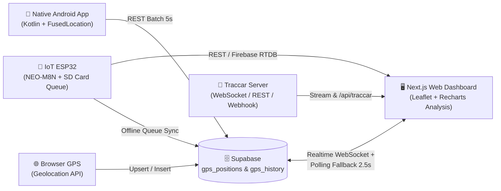

# 🛰️ Tracker by boss (OmniTrack GPS Platform)

ระบบติดตามตำแหน่ง GPS แบบเรียลไทม์หลายแหล่งข้อมูลพร้อมกัน (**Multi-Source Real-Time GPS Tracking & Accuracy Analysis Platform**) รองรับทั้ง **Android Native App**, **Web Browser GPS**, **Traccar Server**, และ **IoT ESP32 (GPS + SD Card)** เชื่อมต่อเข้าสู่ **Supabase PostgreSQL + Realtime** และแสดงผลเปรียบเทียบความแม่นยำบนแผนที่และกราฟวิเคราะห์แบบอัตโนมัติ

---

## 📑 สารบัญ

1. [สถาปัตยกรรมระบบและโครงสร้างโฟลเดอร์](#-สถาปัตยกรรมระบบและโครงสร้างโฟลเดอร์)
2. [เทคโนโลยีที่ใช้ทั้งหมด (Tech Stack)](#-เทคโนโลยีที่ใช้ทั้งหมด-tech-stack)
3. [โครงสร้างฐานข้อมูล Supabase & SQL Script](#-โครงสร้างฐานข้อมูล-supabase--sql-script)
4. [วิธีการเชื่อมต่อแต่ละส่วน (Connection Guide)](#-วิธีการเชื่อมต่อแต่ละส่วน-connection-guide)
5. [หลักการแสดงผลและสูตรคำนวณ Analysis](#-หลักการแสดงผลและสูตรคำนวณ-analysis)
6. [เงื่อนไขการใช้งาน ข้อจำกัด และข้อควรระวัง](#-เงื่อนไขการใช้งาน-ข้อจำกัด-และข้อควรระวัง)

---

## 🏗️ สถาปัตยกรรมระบบและโครงสร้างโฟลเดอร์



### โครงสร้างไฟล์หลักใน Repository

| โฟลเดอร์ / ไฟล์ | หน้าที่หลัก |
| --- | --- |
| `Web/` | เว็บแดชบอร์ด **Next.js 16 (App Router + Turbopack)** สำหรับแสดงแผนที่เปรียบเทียบและวิเคราะห์ความแม่นยำ |
| `Web/src/app/page.tsx` | ตัวควบคุมหลัก, เชื่อมต่อ Supabase Realtime + Polling Fallback, ซิงก์ Browser/Traccar/IoT และคำนวณ Auto Analysis |
| `Web/src/app/api/traccar/route.ts` | API Endpoint (`POST /api/traccar`) สำหรับรับ Webhook จาก Traccar Forwarding |
| `Web/src/components/MapComponent.tsx` | แผนที่ Leaflet พร้อมเส้นทางโค้ง Chaikin, ลูกศรบอกทิศ 8 ทิศ, และการเก็บจุดสะสมจนกว่าจะกด Clear |
| `Web/src/components/DataTables.tsx` | ตาราง **Live Tracking Comparison** (เลือก Device เองได้ + แถบสถานะ `LIVE Xs`) และ **History Log** |
| `Web/src/components/AnalysisPanel.tsx` | แผงวิเคราะห์ความแม่นยำอัตโนมัติ (4 โหมดอ้างอิง, Radar Chart, Best Summary, Device Ranking) |
| `Web/src/hooks/` | `useBrowserGPS.ts`, `useTraccar.ts`, `useIoT.ts`, `useOmniState.ts` |
| `Web/src/utils/calculations.ts` | สูตรคำนวณ Haversine Distance, Forward Bearing (Azimuth), และทิศทางภาษาไทย |
| `MobileApp/` | แอป Android (Kotlin) รัน Background Foreground Service พร้อม WakeLock และ Batch Sync |
| `ESP32_Tracker/ESP32_Tracker.ino` | เฟิร์มแวร์ ESP32 + GPS Module + MH-SD Card พร้อม Offline Queue Sync |
| `.github/workflows/ci.yml` | GitHub Actions CI สำหรับ Build Next.js Web และ Android Debug APK |

---

## 🛠️ เทคโนโลยีที่ใช้ทั้งหมด (Tech Stack)

* **Frontend / Web:** Next.js `16.4.3`, React `19.3.0`, TypeScript `5`, Tailwind CSS, Lucide React
* **Map & Charts:** Leaflet `1.9.4` (OpenStreetMap + Dark Mode Tile Inversion CSS), Recharts `3.10.1` (`RadarChart`)
* **Database & Realtime:** Supabase (`@supabase/supabase-js ^2.117.3`, PostgreSQL, PostgREST, Supabase Realtime `postgres_changes`)
* **IoT Realtime Stream:** Firebase Realtime Database (`useIoT.ts` polling) + ESP32 Direct Supabase REST (`ESP32_Tracker.ino`)
* **Traccar Integration:** Traccar REST API (`/api/positions`), WebSocket (`wss://<host>/api/socket`), HTTP Webhook (`/api/traccar`)
* **Android Mobile App:** Kotlin, Android SDK `26–34`, Google Play Services Location (`FusedLocationProviderClient`), OkHttp `4.12.0`
* **Hardware / Firmware:** ESP32, GPS NEO-M8N / NEO-6M (`TinyGPS++`), MH-SD Card Module (`SPI`, `SD`)

---

## 🗄️ โครงสร้างฐานข้อมูล Supabase & SQL Script

ระบบใช้ตารางหลัก **2 ตาราง** และออกแบบให้รองรับ **Dual-Timestamp** เพื่อแยกเวลาที่เกิดขึ้นจริงบนอุปกรณ์ (`device_time`) ออกจากเวลาที่เซิร์ฟเวอร์ได้รับ (`server_time`) พร้อมกลไกป้องกันข้อมูลค้างคิวเก่ามาเขียนทับพิกัดล่าสุด:

1. **`public.gps_positions`** — เก็บ **ตำแหน่งล่าสุด 1 แถวต่อ 1 อุปกรณ์** (`device_id UNIQUE`) ใช้แสดงบนแผนที่ Realtime และการ์ด Live Tracking Comparison
2. **`public.gps_history`** — เก็บ **ประวัติพิกัดทุกจุดตามลำดับเวลา** ใช้สร้างเส้นทางเดินรถ, Export CSV, และคำนวณสถิติใน Analysis

### SQL Script สำหรับติดตั้งบน Supabase

นำคำสั่งด้านล่างไปวางใน **Supabase Dashboard → SQL Editor → New Query** แล้วกด **Run**:

```sql
-- เปิดใช้งานส่วนขยาย UUID
CREATE EXTENSION IF NOT EXISTS "pgcrypto";

-- ========================================================
-- 1. ตารางเก็บตำแหน่งล่าสุดของแต่ละอุปกรณ์ (gps_positions)
-- ========================================================
CREATE TABLE IF NOT EXISTS public.gps_positions (
    id UUID DEFAULT gen_random_uuid() PRIMARY KEY,
    device_id TEXT UNIQUE NOT NULL,
    device_name TEXT,
    latitude DOUBLE PRECISION NOT NULL,
    longitude DOUBLE PRECISION NOT NULL,
    speed DOUBLE PRECISION DEFAULT 0,
    accuracy DOUBLE PRECISION,
    source TEXT,                              -- 'native' | 'browser' | 'traccar' | 'iot'
    app_status TEXT DEFAULT 'Tracking Active',
    is_online BOOLEAN DEFAULT true,
    device_time TIMESTAMPTZ DEFAULT NOW(),    -- เวลาจริงจาก GPS / อุปกรณ์
    server_time TIMESTAMPTZ DEFAULT NOW(),    -- เวลาที่เซิร์ฟเวอร์ได้รับข้อมูล
    updated_at TIMESTAMPTZ DEFAULT NOW()
);

-- ========================================================
-- 2. ตารางเก็บประวัติพิกัดย้อนหลัง (gps_history)
-- ========================================================
CREATE TABLE IF NOT EXISTS public.gps_history (
    id UUID DEFAULT gen_random_uuid() PRIMARY KEY,
    device_id TEXT NOT NULL,
    latitude DOUBLE PRECISION NOT NULL,
    longitude DOUBLE PRECISION NOT NULL,
    speed DOUBLE PRECISION DEFAULT 0,
    accuracy DOUBLE PRECISION,
    source TEXT,                              -- 'native' | 'browser' | 'traccar' | 'iot'
    device_time TIMESTAMPTZ DEFAULT NOW(),    -- เวลาจริงจาก GPS / อุปกรณ์
    server_time TIMESTAMPTZ DEFAULT NOW(),    -- เวลาที่เซิร์ฟเวอร์บันทึกลง DB
    -- ป้องกันการบันทึกจุดซ้ำซ้อนจากคิว Retry หรือการส่งซ้ำ
    CONSTRAINT uq_gps_history_device_time UNIQUE (device_id, device_time)
);

-- Index สำหรับเร่งความเร็วในการดึงเส้นทางและเรียงลำดับเวลา
CREATE INDEX IF NOT EXISTS idx_gps_positions_updated
    ON public.gps_positions (updated_at DESC);

CREATE INDEX IF NOT EXISTS idx_gps_history_device_time
    ON public.gps_history (device_id, device_time DESC);

CREATE INDEX IF NOT EXISTS idx_gps_history_server_time
    ON public.gps_history (server_time DESC);

-- ========================================================
-- 3. Trigger ซิงก์ข้อมูลจาก gps_history -> gps_positions (Queue-Safe)
--    ป้องกันข้อมูล Offline Queue ที่มาช้ากว่าเขียนทับพิกัดล่าสุด
-- ========================================================
CREATE OR REPLACE FUNCTION public.fn_sync_latest_gps_position()
RETURNS TRIGGER AS $$
BEGIN
    INSERT INTO public.gps_positions (
        device_id,
        device_name,
        latitude,
        longitude,
        speed,
        accuracy,
        source,
        app_status,
        is_online,
        device_time,
        server_time,
        updated_at
    )
    VALUES (
        NEW.device_id,
        NEW.device_id,
        NEW.latitude,
        NEW.longitude,
        COALESCE(NEW.speed, 0),
        NEW.accuracy,
        NEW.source,
        'Tracking Active',
        true,
        COALESCE(NEW.device_time, NOW()),
        NOW(),
        NOW()
    )
    ON CONFLICT (device_id) DO UPDATE
    SET
        latitude    = EXCLUDED.latitude,
        longitude   = EXCLUDED.longitude,
        speed       = EXCLUDED.speed,
        accuracy    = EXCLUDED.accuracy,
        source      = EXCLUDED.source,
        app_status  = 'Tracking Active',
        is_online   = true,
        device_time = EXCLUDED.device_time,
        server_time = NOW(),
        updated_at  = NOW()
    -- อัปเดตตำแหน่งล่าสุดเฉพาะเมื่อเวลาจริงของอุปกรณ์ใหม่กว่าหรือเท่ากับของเดิม
    WHERE EXCLUDED.device_time >= COALESCE(gps_positions.device_time, to_timestamp(0));

    RETURN NEW;
END;
$$ LANGUAGE plpgsql;

DROP TRIGGER IF EXISTS trg_sync_gps_positions ON public.gps_history;
CREATE TRIGGER trg_sync_gps_positions
AFTER INSERT ON public.gps_history
FOR EACH ROW
EXECUTE FUNCTION public.fn_sync_latest_gps_position();

-- ========================================================
-- 4. สิทธิ์การใช้งาน (Prototype) และเปิด Supabase Realtime
-- ========================================================
ALTER TABLE public.gps_positions DISABLE ROW LEVEL SECURITY;
ALTER TABLE public.gps_history DISABLE ROW LEVEL SECURITY;

-- เปิด Publication สำหรับ Realtime (postgres_changes)
DO $$
BEGIN
    IF NOT EXISTS (SELECT 1 FROM pg_publication WHERE pubname = 'supabase_realtime') THEN
        CREATE PUBLICATION supabase_realtime;
    END IF;
END $$;

ALTER PUBLICATION supabase_realtime ADD TABLE public.gps_positions;
ALTER PUBLICATION supabase_realtime ADD TABLE public.gps_history;
```

> **หมายเหตุสำหรับแอป Android (`MobileApp`):** ใน `SupabaseClient.kt` มีการส่งฟิลด์ `recorded_at` เข้า `gps_history` หากต้องการรองรับทั้ง `recorded_at` และ `device_time` สามารถเพิ่มคอลัมน์ `recorded_at TIMESTAMPTZ DEFAULT NOW()` ใน `gps_history` และใช้ `COALESCE(NEW.device_time, NEW.recorded_at, NOW())` ใน Trigger ได้

### 🚀 การรองรับข้อมูลระดับ 1,000,000+ แถว (`supabase_scale_1m.sql`)

เพื่อไม่ให้เกินเพดาน 1,000 แถวต่อคำขอของ PostgREST และไม่ให้เบราว์เซอร์ค้างเมื่อมีพิกัดสะสมหลายล้านจุด ให้รันไฟล์ [`supabase_scale_1m.sql`](./supabase_scale_1m.sql) ใน Supabase SQL Editor เพิ่มเติม ซึ่งประกอบด้วย:
* **BRIN + Composite B-Tree Indexes:** ลดขนาด Index และเร่งความเร็ว Query Time-Series ระดับล้านแถว
* **`get_route_decimated(p_points_per_device)`:** ลดรูปเส้นทางบน PostgreSQL Server ให้เหลือไม่เกิน `600` จุด/เครื่อง อย่างสม่ำเสมอ (เก็บจุดแรกและจุดสุดท้ายเสมอ)
* **`get_accuracy_analysis(p_ref_lat, p_ref_lng)` & `get_history_centroid()`:** คำนวณ Haversine Error, Mean, Std Dev, Min/Max และ Centroid บน PostgreSQL ทั้งหมด 1,000,000+ แถวแล้วส่งเฉพาะผลสรุปรายเครื่องกลับมาที่หน้าเว็บ
* **Frontend Optimization:** แผนที่เปิด `preferCanvas: true` + Decimation (`decimatePoints`), History Log แบ่งหน้าแบบ Server-Side (`50` แถว/หน้า ด้วย `.range()`), และ Export CSV ดึงแบบ Chunk ทีละ 1,000 แถว

---

## 🔌 วิธีการเชื่อมต่อแต่ละส่วน (Connection Guide)

### 1. Web Dashboard (`Web/`)

1. ติดตั้ง Dependencies:
   ```bash
   cd Web
   npm install
   ```
2. สร้างไฟล์ `Web/.env.local`:
   ```env
   NEXT_PUBLIC_SUPABASE_URL=https://YOUR_PROJECT_ID.supabase.co
   NEXT_PUBLIC_SUPABASE_ANON_KEY=YOUR_SUPABASE_ANON_KEY
   NEXT_PUBLIC_TRACCAR_TOKEN=YOUR_TRACCAR_API_TOKEN
   NEXT_PUBLIC_DEVICE_NAME=ESP32_Tracker
   # (ตัวเลือกเสริม) ใช้ยืนยันตัวตน Webhook POST /api/traccar
   TRACCAR_SECRET=YOUR_WEBHOOK_SECRET
   ```
3. รันเซิร์ฟเวอร์พัฒนา หรือ Build Production:
   ```bash
   # โหมดพัฒนา
   npm run dev

   # โหมด Production
   npm run build
   npm run start
   ```
4. **กลไกการซิงก์แบบเรียลไทม์บนเว็บ:**
   * เชื่อมต่อ **Supabase Realtime** (`postgres_changes`) บนตาราง `gps_positions` และ `gps_history`
   * ทำงานร่วมกับ **Polling Fallback ทุก 2.5 วินาที** เพื่อป้องกันปัญหา WebSocket หลุดเงียบระหว่างเปิดหน้าจอนานๆ
   * สามารถแก้ไขชื่อ Browser Device ได้จากไอคอนดินสอข้างชื่อ Device บน Header (`localStorage: omni_device_name`)

---

### 2. Browser GPS (`useBrowserGPS.ts`)

* กดปุ่ม **`GPS: OFF`** → เปลี่ยนเป็น **`GPS: ON`** บนแถบควบคุม
* ระบบเรียก `navigator.geolocation.watchPosition` (`enableHighAccuracy: true, timeout: 20000, maximumAge: 5000`) และปล่อยค่าซ้ำทุก **2 วินาที** เมื่ออยู่นิ่ง
* **เงื่อนไขการบันทึกประวัติ (`gps_history`):** บันทึกลง History เฉพาะเมื่อเคลื่อนที่ **> 3 เมตร** หรือผ่านไป **> 30 วินาที** เพื่อไม่ให้ฐานข้อมูลบวมเกินจำเป็น ส่วน `gps_positions` และหน้า UI จะอัปเดตทันที (Optimistic Update)

---

### 3. Native Android App (`MobileApp/`)

* **วิธี Build:** เปิดโฟลเดอร์ `MobileApp/` ด้วย Android Studio (JDK 17, `minSdk 26`, `targetSdk 34`) หรือดาวน์โหลด Artifact APK จาก GitHub Actions (`.github/workflows/ci.yml`)
* **การตั้งค่า:** แก้ไข `supabaseUrl` และ `supabaseKey` ใน `MobileApp/app/src/main/java/com/omnitrack/tracker/SupabaseClient.kt` ให้ตรงกับโปรเจกต์ Supabase ของคุณ
* **หลักการทำงาน (`LocationService.kt`):**
  * รันเป็น **Foreground Service** (`foregroundServiceType="location"`) พร้อมถือ `PARTIAL_WAKE_LOCK` เพื่อไม่ให้ระบบตัดการทำงานเมื่อปิดหน้าจอ
  * อ่านพิกัดจาก `FusedLocationProviderClient` ทุก `2 วินาที` (ค่าเริ่มต้น `gpsInterval = 2`) และรวมส่งแบบ Batch เข้า Supabase ทุก `5 วินาที` (`syncInterval = 5`)
  * แปลงความเร็วจาก `m/s` เป็น `km/h` (`speed * 3.6`) และแนบ `source = "native"`

---

### 4. Traccar Integration (`useTraccar.ts` และ `/api/traccar`)

เชื่อมต่อได้ **2 รูปแบบ**:

* **แบบที่ A: Client Stream (REST + WebSocket)**
  1. เข้าสู่ระบบบน Traccar Web UI (เช่น `https://demo.traccar.org`)
  2. ไปที่เมนูซ้ายบน **Preferences** → หัวข้อ **Token** → กำหนดวันหมดอายุแล้วกดสร้าง **API Token** *(หมายเหตุ: ต้องใช้ Token จาก Preferences เท่านั้น ไม่ใช่ Notification Tokens ในหน้า Account)*
  3. นำ Token มาใส่ใน `NEXT_PUBLIC_TRACCAR_TOKEN` (ใน `.env.local` หรือ `localStorage: omni_traccar_token`)
  4. เว็บจะดึงพิกัดเริ่มต้นผ่าน `GET https://demo.traccar.org/api/positions` และรับ Stream ผ่าน `wss://demo.traccar.org/api/socket?token=...` โดยแปลงหน่วยความเร็วจาก Knots เป็น km/h (`speed * 1.852`)

* **แบบที่ B: Server Webhook Forwarding (`POST /api/traccar`)**
  * ตั้งค่า Traccar Server ให้ Forward ตำแหน่งแบบ JSON มาที่:
    ```text
    https://<your-domain>/api/traccar?token=<TRACCAR_SECRET>
    ```
  * Endpoint จะแยกค่า `device`, `latitude`, `longitude`, `speed * 1.852`, `accuracy`, `fixTime` แล้วบันทึกลงทั้ง `gps_positions` และ `gps_history` (`source: "traccar"`) อัตโนมัติ

---

### 5. IoT ESP32 (`ESP32_Tracker/ESP32_Tracker.ino` และ `useIoT.ts`)

#### การต่อสายฮาร์ดแวร์ (Pinout)

| โมดูล | ขาของโมดูล | ขาของ ESP32 (GPIO) | หมายเหตุ |
| --- | --- | --- | --- |
| **GPS (NEO-M8N / 6M)** | `TX` | `GPIO 16` (`RX2`) | UART2 Baud Rate `9600` |
| **GPS (NEO-M8N / 6M)** | `RX` | `GPIO 17` (`TX2`) | UART2 Baud Rate `9600` |
| **MH-SD Card Module** | `CS` | `GPIO 5` | SPI VSPI |
| **MH-SD Card Module** | `SCK` | `GPIO 18` | SPI VSPI |
| **MH-SD Card Module** | `MISO` | `GPIO 19` | SPI VSPI |
| **MH-SD Card Module** | `MOSI` | `GPIO 23` | SPI VSPI |

#### การตั้งค่าและหลักการทำงานของเฟิร์มแวร์
1. ติดตั้งไลบรารี **`TinyGPSPlus`** ใน Arduino IDE
2. แก้ค่า `WIFI_SSID`, `WIFI_PASSWORD`, `DEVICE_ID`, `SUPABASE_URL`, และ `SUPABASE_KEY` ใน `ESP32_Tracker.ino`
3. ระบบส่งข้อมูลทุก **5 วินาที** (`LOG_INTERVAL_MS = 5000`) และคำนวณ `accuracy ≈ HDOP × 5.0` เมตร
4. ดึงเวลาจากดาวเทียม GPS แปลงเป็นเวลาไทย **UTC+7** (`+25200` วินาที) และใช้ NTP (`pool.ntp.org`) เป็นเวลาสำรอง
5. **ระบบ SD Card & Offline Queue:**
   * บันทึก Log ทุกจุดลง `/gps_log.csv`
   * หาก Wi-Fi หลุดหรือส่ง Supabase ไม่สำเร็จ จะพัก JSON ลง `/offline_queue.jsonl`
   * เมื่อ Wi-Fi กลับมา ระบบจะเรียก `flushOfflineQueue()` ทุก **10 วินาที** (ครั้งละ 5 รายการ) เพื่อซิงก์เข้า `gps_history` และให้ Database Trigger อัปเดต `gps_positions` เฉพาะจุดที่ใหม่กว่า
6. นอกจากนี้ `useIoT.ts` บนเว็บยังรองรับการอ่านข้อมูล IoT จาก Firebase Realtime Database (`IOT_FIREBASE_URL`) ทุก **2 วินาที** เพื่อนำมาแสดงผลร่วมกับ Supabase ได้ด้วย

---

## 📐 หลักการแสดงผลและสูตรคำนวณ Analysis

### 1. การคำนวณระยะทางและความคลาดเคลื่อน (Haversine Formula)

ใช้คำนวณระยะทางจริงบนพื้นผิวทรงกลมโลกระหว่างพิกัด 2 จุด `(lat1, lon1)` และ `(lat2, lon2)` (เช่น ระยะห่างระหว่างจุดวัดกับจุดอ้างอิง หรือระยะทางสะสมตลอดเส้นทาง):

$$a = \sin^2\left(\frac{\Delta\phi}{2}\right) + \cos(\phi_1)\cos(\phi_2)\sin^2\left(\frac{\Delta\lambda}{2}\right)$$

$$d = 2 R \cdot \operatorname{atan2}\left(\sqrt{a}, \sqrt{1 - a}\right), \quad R = 6,371,000\text{ เมตร}$$

---

### 2. ทิศทางการเคลื่อนที่ (Forward Azimuth / Bearing)

คำนวณมุมทิศทางจากจุดก่อนหน้าไปยังจุดถัดไปใน `calculateBearing()` อยู่ในช่วง `0°–360°` (`0° = เหนือ, 90° = ตะวันออก, 180° = ใต้, 270° = ตะวันตก`):

$$\theta = \operatorname{atan2}\left(\sin(\Delta\lambda)\cos(\phi_2),\; \cos(\phi_1)\sin(\phi_2) - \sin(\phi_1)\cos(\phi_2)\cos(\Delta\lambda)\right)$$

$$\text{Bearing} = \left(\theta \cdot \frac{180}{\pi} + 360\right) \bmod 360$$

จากนั้นแปลงเป็นทิศหลัก 8 ทิศ (`↑ N`, `↗ NE`, `→ E`, `↘ SE`, `↓ S`, `↙ SW`, `← W`, `↖ NW`) แสดงบนจุด Waypoint ทุกจุดและหัวหมุดปัจจุบัน

---

### 3. การทำให้เส้นทางโค้งนุ่มนวล (Chaikin Curve Subdivision)

ใน `MapComponent.tsx` หากมีจุดตั้งแต่ 3 จุดขึ้นไป จะผ่าน **Chaikin Subdivision (1-pass)** เพื่อลบมุมหักแหลมของ GPS:

$$Q_i = 0.75 P_i + 0.25 P_{i+1}, \qquad R_i = 0.25 P_i + 0.75 P_{i+1}$$

และระบบจะ **เก็บจุดเก่าสะสมไว้ตลอด (`accumulatedByDeviceRef`)** ไม่ลบจุดเดิมออกจนกว่าผู้ใช้จะกดปุ่ม **Clear**

---

### 4. Live Tracking Comparison (เลือก Device เปรียบเทียบเองได้)

* การ์ดเปรียบเทียบทั้ง 4 ช่องเรียงข้อมูลตามเวลาอัปเดตล่าสุด (`updated_at || server_time || device_time`)
* แสดงป้ายสถานะเวลาสดอัปเดตทุก 1 วินาที (`LIVE Xs` สีเขียวกระพริบเมื่ออัปเดตภายใน 15 วินาที, สีส้มภายใน 120 วินาที)
* ผู้ใช้เลือกสลับ Device เฉพาะในแต่ละช่องหรือเทียบข้ามกลุ่มได้ผ่าน Dropdown ของแต่ละการ์ด

---

### 5. หลักการ Accuracy Analysis (คำนวณอัตโนมัติ)

เมื่อเปิดแผง **Analysis** ระบบจะคำนวณแบบอัตโนมัติทันที (`useMemo`) โดยเลือกจุดอ้างอิง $(\phi_{\text{ref}}, \lambda_{\text{ref}})$ ได้ **4 โหมด**:

1. **`Auto (ค่าเฉลี่ย / Centroid)` *(ค่าเริ่มต้น)*:** หาจุดศูนย์กลางเฉลี่ยจากพิกัดทั้งหมดที่มีอยู่ เหมาะสำหรับดูการกระจายตัว (Precision/Drift) โดยไม่ต้องกรอกพิกัดเอง
   $$\phi_{\text{ref}} = \frac{1}{N}\sum_{i=1}^{N}\phi_i, \qquad \lambda_{\text{ref}} = \frac{1}{N}\sum_{i=1}^{N}\lambda_i$$
2. **`เทียบ Device หลัก`:** ใช้พิกัดล่าสุดของอุปกรณ์ที่เลือกเป็นจุดอ้างอิง เพื่อเทียบส่วนต่างระหว่างอุปกรณ์จริง
3. **`Live GPS`:** เปิด Browser GPS อัตโนมัติ (หากปิดอยู่) และใช้พิกัด GPS ปัจจุบันเป็นจุดอ้างอิง
4. **`กำหนดเอง (Manual)`:** กรอกค่า Latitude / Longitude ของจุดสำรวจจริงแล้วคำนวณทันที

**ตัวชี้วัดทางสถิติที่ใช้ประเมินแต่ละ Source และราย Device (`Device Accuracy Ranking`):**
* **Samples ($N$):** จำนวนจุดพิกัดที่ใช้วิเคราะห์ (ตัดพิกัด `0, 0` ออก)
* **Mean Error ($\bar{e}$):** ค่าเฉลี่ยความคลาดเคลื่อนเป็นเมตรเทียบกับจุดอ้างอิง ($\frac{1}{N}\sum e_i$, ยิ่งต่ำยิ่งแม่นยำ)
* **Standard Deviation ($\sigma$):** ความแปรปรวน/การแกว่งของสัญญาณ ($\sqrt{\frac{1}{N}\sum (e_i - \bar{e})^2}$, ยิ่งต่ำยิ่งนิ่ง)
* **Min / Max Error:** ความคลาดเคลื่อนต่ำสุดและสูงสุด
* **Avg Reported Accuracy:** ค่าความแม่นยำเฉลี่ยที่อุปกรณ์รายงานกลับมาเอง (เมตร)
* **Error Ratio Bar:** สัดส่วนเปรียบเทียบ $\frac{\bar{e}}{\max(\bar{e}_{\text{all}})} \times 100\%$ และสรุปผู้ชนะบน **Best Accuracy Summary** + **Radar Chart**

---

## ⚠️ เงื่อนไขการใช้งาน ข้อจำกัด และข้อควรระวัง

1. **สิทธิ์การใช้ GPS บนเบราว์เซอร์ (HTTPS Requirement):**
   * `navigator.geolocation` ทำงานได้เฉพาะบน **`https://`** (เช่น Vercel) หรือ **`http://localhost`** เท่านั้น หากเปิดผ่าน IP LAN แบบ `http://192.168.x.x` เบราว์เซอร์จะบล็อกการเข้าถึง GPS
2. **การตั้งค่า Android Background Location:**
   * ต้องอนุญาตสิทธิ์ Location แบบตลอดเวลา (`ACCESS_BACKGROUND_LOCATION`), อนุญาต Foreground Notification และปิดโหมดประหยัดแบตเตอรี่ (Battery Optimization) เพื่อไม่ให้ Android หยุดส่งพิกัดเมื่อล็อกหน้าจอ
3. **ข้อจำกัดจำนวนแถวเริ่มต้นของ Supabase (PostgREST Max Rows):**
   * Frontend ขอข้อมูลประวัติสูงสุด `limit(10000)` แต่ค่าเริ่มต้นของ Supabase PostgREST API มักจำกัดไว้ที่ **1,000 แถวต่อคำขอ** หากต้องการดึงย้อนหลังมากกว่า 1,000 จุด ให้ปรับค่า **Max Rows** ใน *Supabase → Project Settings → API*
4. **ความถูกต้องของนาฬิกาอุปกรณ์ (Device Clock Skew):**
   * ระบบอาศัย `device_time` เป็นตัวเรียงเส้นทางและกันข้อมูลเก่าเขียนทับ หากเวลาของ ESP32 หรืออุปกรณ์ส่งมาผิดพลาด (เช่น ล้ำอนาคต) อาจทำให้ข้อมูลนั้นถูกมองว่าใหม่กว่าข้อมูลปัจจุบันบนฐานข้อมูลควรตรวจสอบ Timezone/NTP ให้ถูกต้อง
5. **ความปลอดภัยของฐานข้อมูล (Security & RLS):**
   * สคริปต์ฐานข้อมูลข้างต้นปิด **Row Level Security (RLS)** เพื่อความสะดวกในการทดสอบระหว่าง Embedded/Mobile/Web ในระบบใช้งานจริง (Production) ควรเปิด RLS และจำกัดสิทธิ์การเขียนผ่าน API Key / Auth เฉพาะอุปกรณ์ และ **ห้าม Commit รหัสผ่าน Wi-Fi หรือ Token ส่วนตัว** ลง Public Repository
6. **ข้อจำกัดของ Traccar Demo Server (`demo.traccar.org`):**
   * เป็นเซิร์ฟเวอร์สาธารณะสำหรับการทดลอง อาจเกิดอาการตอบสนองช้า (`Timeout`), จำกัด Rate Limit หรือมีการล้างข้อมูลเป็นระยะตามนโยบายของผู้ให้บริการ
7. **คำเตือนการล้างข้อมูล (Clear Data):**
   * ปุ่ม **Clear** บนหน้าเว็บจะสั่งลบข้อมูลทั้งหมดใน `gps_positions` และ `gps_history` บน Supabase **อย่างถาวรและไม่สามารถกู้คืนได้** ควรกด **Export CSV** เก็บข้อมูลไว้ก่อนทุกครั้ง
